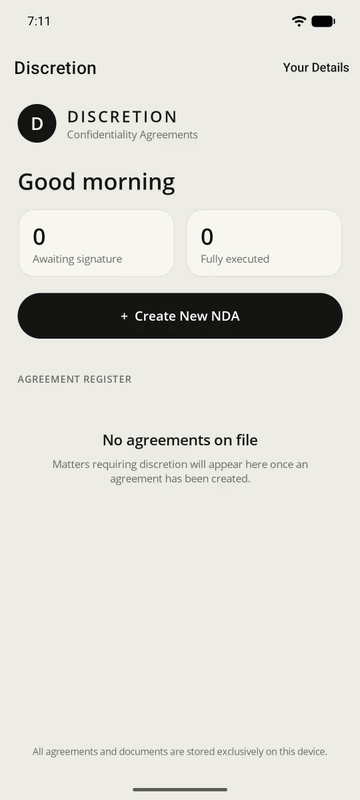

# Discretion

A deadly-serious-looking .NET 11 MAUI app (Android + macOS via Mac Catalyst) for requesting that someone sign a
Non-Disclosure Agreement about matters such as karaoke performances, restroom incidents, or a post-extramarital affair.

> For entertainment purposes only. Generated documents are not legal advice.

## Demo

<p align="center">
  
</p>

Recorded on Android: set up *Your Details* (Disclosing Party: Jordan Huang), then create a Post-Extramarital Affair NDA
for Alice Huang, sign it for both parties on the device and open the executed agreement.
[Full-quality video (MP4)](docs/demo.mp4)

All names, contact details and signatures shown are fictional.

## Workflow

1. **Create New NDA** (first run asks for *Your Details*, used as the Disclosing Party)
2. Select a template (13 included, e.g. Confidential Discussion, Post-Extramarital Affair, Recreational Substance Use)
3. Term of the agreement (months/years)
4. Whether confidentiality survives expiration
5. Receiving party (name, phone, email, address)
6. Governing state law
7. Effective date
8. Review & **Save** – the PDF is generated on the device, then the Disclosing Party is prompted to sign,
   followed by a prompt to hand the device to the Receiving Party.

Each signature regenerates the PDF. Executed copies can be shared, emailed to the receiving party, or followed up by text.

## Project layout

| Path | Purpose |
| --- | --- |
| `Services/TemplateCatalog.cs` | NDA templates (recitals, definitions, special covenants) |
| `Services/NdaComposer.cs` | Assembles the legal text into a renderer-agnostic document model |
| `Services/Pdf/` | Dependency-free PDF writer (standard Times fonts, justified text, vector signatures) |
| `Services/AgreementStore.cs` | JSON persistence in the app data directory |
| `Controls/SignaturePad.cs` | Touch/mouse signature capture (`GraphicsView`) |
| `Views/`, `ViewModels/` | Dashboard, 7-step wizard, agreement/execution page, signing, document preview |

## Build & run

Requires the .NET 11 SDK and the MAUI workload.

```bash
dotnet workload install maui-android maui-maccatalyst   # maccatalyst on macOS only

# Android (device or emulator)
dotnet build -t:Run -f net11.0-android

# macOS (on a Mac with Xcode installed)
dotnet build -t:Run -f net11.0-maccatalyst
```

The `net11.0-maccatalyst` target is only included when building on macOS.

## CI/CD & releasing

See the [CI/CD and releasing guide](docs/ci-cd.md) for workflows, Conventional Commits, release artifacts, and signing setup.
